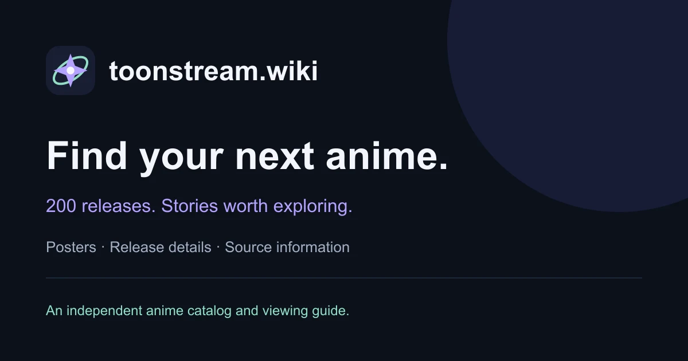

# Toonstream Wiki

**Find your next anime, explore its story, and understand where a source link takes you.**

[Explore Toonstream Wiki](https://toonstream.wiki/) · [Browse the catalog](https://toonstream.wiki/browse/)

## Explore 200 releases

Browse 150 series and 50 movies with individual posters, story overviews, release details and reference links. Search by title or alias, combine format and genre filters, or explore the curated selections on the home page.

Each entry identifies its release or season, helping you distinguish similarly named editions. Clear source notes explain whether a link is a reference page or a viewing-platform entry.

## Helpful guides

- [Toonstream access guide](https://toonstream.wiki/toonstream-access-guide/)
- [Toonstream alternatives](https://toonstream.wiki/toonstream-alternatives/)
- [About this independent project](https://toonstream.wiki/about/)
- [Contact and corrections](https://toonstream.wiki/contact/)

Toonstream Wiki is an independent catalog, not an official Toonstream service. It does not host full episodes or movies. External availability, subscriptions and audio languages depend on the provider and your region; a reference link is not a promise of playback. Posters and titles belong to their respective rights holders.
